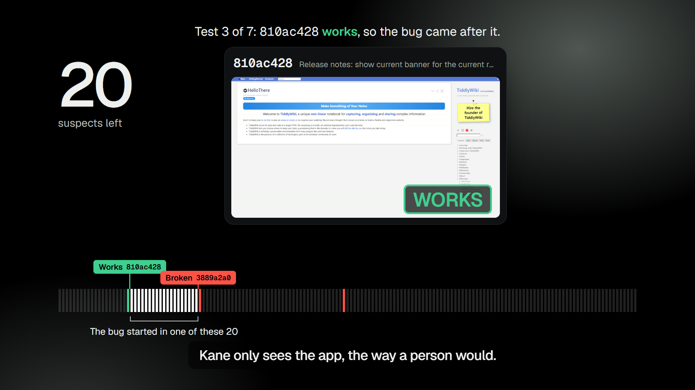

# Gumshoe

**Paste a bug report. Get the commit that broke it. No test needed.**

**Live:** https://gumshoe-puce.vercel.app · **Demo video (3 min):** https://youtu.be/rB-APBY7JPs

Built for the KaneCLI Online Hackathon by TestMu AI.



## The problem

A feature that worked last month is broken. Somewhere in hundreds of commits is the one change that did it. Finding it by hand means building old versions and clicking through each one. That takes hours.

## What Gumshoe does

1. You give it a link to a GitHub bug report.
2. Claude turns the report into one plain sentence, like "Ctrl+Enter in the tags box saves the tiddler."
3. [Kane CLI](https://www.npmjs.com/package/@testmuai/kane-cli) checks that sentence in a real browser on old versions of the app. `git bisect` picks which version to test next, halving the suspects each time.
4. One commit is left. Claude Code fixes it, Kane checks the same sentence on the fix, and the sentence is saved as a Kane test.

All tests were on **real bugs in real open-source apps** (TiddlyWiki, Excalidraw). None were planted. In 6 of 6 cases where the maintainers had named a commit, Gumshoe named the same one.

## Look around in 2 minutes

1. Open https://gumshoe-puce.vercel.app. No sign-up.
2. Click **Find the commit** (a solved report is already in the box), or tap one of the other solved reports.
3. Scroll down to watch the search: each test, the screenshot Kane saw, and its answer, until one commit is left.

## Run it yourself

Check every recorded result again on your own computer. No Kane account, no AI, no network, nothing to install (Node 22.18 or newer):

```bash
git clone https://github.com/Maveri-Q/Gumshoe.git
cd Gumshoe
npm run replay
npm test
```

`npm run replay` reads Kane's own recorded output for every commit again, works out every verdict with the same code the live run used, walks the bisects again, and rebuilds the report page. It stops with an error if anything differs from what was recorded. One thing is taken as recorded: the second reader's answer about each saved screen. The pictures are already in `site/img`.

### A live hunt

To run a live hunt you need Kane (`kane-cli login`), Claude Code, git and Chrome. With `--cheap` it costs about 120 Kane credits and about 35 minutes. Without it, 400 to 1,500 credits and 1 to 2.5 hours:

```bash
git clone --filter=blob:none https://github.com/TiddlyWiki/TiddlyWiki5.git clones/tiddlywiki
npm run hunt -- https://github.com/TiddlyWiki/TiddlyWiki5/issues/9592 --app tiddlywiki --cheap
npm run fix -- tiddlywiki-9592
```

## The best one: TiddlyWiki issue 9592

- The report was written on 18 Jan 2026. The maintainers named the cause on 26 Jan, 8 days later.
- Gumshoe got only the title and the first post. Comments were left out, because they can hold the answer.
- It wrote the sentence: "Clicking an HTML anchor link that points to a spot inside the same tiddler keeps that tiddler on screen and does not open another tiddler."
- 168 commits were searched. It ended on `48eeb460`, "Deprecate and simplify some utility functions (#9251)".
- We had not looked up the answer. Then we did: the maintainers' fix, [#9622](https://github.com/TiddlyWiki/TiddlyWiki5/pull/9622), blames #9251.

- Claude Code fixed it on the first attempt, without seeing the maintainers' fix. Kane checked the same sentence twice: it works.
- The saved test, [kane-tests/tiddlywiki-9592_test.md](kane-tests/tiddlywiki-9592_test.md), passes on the fix and fails on the broken version.
- TiddlyWiki's own tests give the same result before and after the fix: 72 of 1,404 fail here on Windows both times.

## The newest one: TiddlyWiki issue 9574

- The report is one sentence: Ctrl+Enter no longer saves when the cursor is in the tags box.
- Gumshoe named `3889a2a0`, "Fix nested span.tc-keyboard element in core (#9235)". 161 commits, 120 credits, first draft of the check.
- We looked up the answer afterwards. Nobody in the report had settled on a commit. Seven days in, one person [suspected 23f0a9bf](https://github.com/TiddlyWiki/TiddlyWiki5/issues/9574#issuecomment-3769486600), a change to dragging links, and wrote that undoing it did not help.
- We settled it with a plain script, no Kane and no AI ([check.mjs](validation/9574-script/check.mjs), [result](validation/9574-script/result.json)):

| Commit | Ctrl+Enter |
|---|---|
| 34737f4e, just before Gumshoe's commit | works |
| **3889a2a0, Gumshoe's commit** | **broken** |
| 40cc62f7, just before the suspect | already broken |
| 23f0a9bf, the suspect | broken |
| bad87c40, the commit the suspect was compared with | works |

The commit it was compared with is on a side branch that doesn't have #9235. That explains the mix-up. `git bisect` doesn't have this problem, because it only compares commits on one line of history.

- Claude Code fixed it on the first attempt. Kane's look says it works, and the saved test passes on the fix and fails on the broken version. TiddlyWiki's own tests: 72 of 1,404 fail before and after.
- One thing to know: while choosing this bug, we saw a different report (9323) that mentions #9235. We did not link the two, and Gumshoe was not given it.

## Does the check give the same answer every time?

We ran the saved 9574 check 10 times on the last commit that works and 10 times on the guilty one. Every run was kept ([results](validation/steady-9574/result.json)).

| Commit | Runs | Answer |
|---|---|---|
| 34737f4e, just before | 10 | works, 10 of 10 |
| 3889a2a0, the guilty one | 10 | broken, 10 of 10 |

All 20 replayed the recording, none fell back to Kane doing the steps. Cost: 59 credits, 26 minutes. Run it again with `sh validation/steady-9574/run.sh`.

## Cheap mode

Most of the cost was Kane working out the same clicks again on every commit. So now Kane does the steps once and saves a recording. Every other commit replays that recording. Kane's AI is used only for the look at the end. If a recording doesn't fit an older version, Kane does the steps itself.

We ran the 9592 bisect again this way, with the same check and the same two ends:

| | Guilty commit | Tries (refused) | Time | Credits |
|---|---|---|---|---|
| First time | 48eeb460 | 15 (1) | 59 min | 531 |
| Cheap mode | 48eeb460 | 14 (0) | 20 min | 46, plus 42 once for the recording |

## Scoreboard

| Report | Gumshoe says | Maintainers say | Commits searched | Tries (refused) | Time | Credits |
|---|---|---|---|---|---|---|
| TiddlyWiki 9592 | 48eeb460 | same | 168 | 22 (3) | 83 min | 790 |
| TiddlyWiki 9574, cheap mode | 3889a2a0 | not settled, a script agrees | 161 | 19 (1) | 32 min | 120 |
| TiddlyWiki 9678 | c305eb01 | same, through a linked report | 234 | 27 (4) | 93 min | 972 |
| TiddlyWiki 9760 | c305eb01 | same | 262 | 31 (10) | 146 min | 1,526 |
| Excalidraw 10772 | 63e11482 | same | 48 | 19 (2) | 65 min | 664 |
| Excalidraw 10772, by hand | 63e11482 | same | 56 | 17 (1) | 35 min | 369 |
| Excalidraw 12053, by hand | e1bb9ff8 | same | 70 | 18 (0) | 35 min | 356 |

7 hunts, 6 reports, 5 different guilty commits. In 6 of 6 where the maintainers named a commit, it is the same one. Only 9592 and 9574 were run without us having looked for the answer first. We knew the answer for 9760 and 10772, and a likely one for 9678. Gumshoe itself was not told any of them, except that 10772's own title names #10578.

Time counts the commits in the final result. Our real spend on the whole project was about 6,740 credits, including failed drafts, calibrations and tries cut off by sleep.

More on the report page (`site/index.html`), or run `npm run replay`.

## How it works

1. **Read the issue** ([tools/issue.ts](tools/issue.ts)). Title and first post only.
2. **Write the check** ([tools/write-check.ts](tools/write-check.ts)). Claude writes the sentence, the steps, and two opposite statements about the end screen. It can't see the git history.
3. **Show the bug** ([tools/hunt.ts](tools/hunt.ts)). Kane runs the check on the version the reporter used. If the bug doesn't show, Claude gets Kane's notes and tries again, three drafts at most. After that the check is frozen.
4. **Find a version that works.** The one the report names, or the releases before it.
5. **Bisect.** The real `git bisect run`. Each commit is built, served on this computer, and judged.
6. **Fix it** ([tools/fix.ts](tools/fix.ts)). Claude Code gets the source without its git history. Three attempts at most, then a human. Gumshoe compares hashes to make sure the agent did not touch the check.
7. **Keep it.** The sentence becomes a Kane test file in [kane-tests](kane-tests), run once on the fix and once on the broken version.

### Why Kane
A bug hunt goes back through months of code. Tests that look for elements by code name break along the way. A sentence still means the same thing on an old version.

### How a verdict is made
All the decisions are plain code in [tools/verdict.ts](tools/verdict.ts).
- One Kane run does the steps and says if the app was ready.
- A second Kane run only looks at the page (`--analyzer-only --condition`). It judges "broken" and "working". If it says both or neither, the try is refused.
- A second reader (Claude) sees the saved screenshot and nothing else. If it disagrees, the try is refused.
- Two tries must agree. Three tries at most. If they don't, the commit is skipped, never guessed.
- A crash, a lost connection or a failed build can't count as "broken".

## Where it went wrong
- **Kane's answer was wrong 3 times out of 3** on a good commit in our first calibration. Its own screenshots showed the right thing. That is why a separate look-only run exists. ([validation/phase1](validation/phase1))
- **Kane contradicted itself** many times. Those tries are in the recordings, refused.
- **First drafts failed, and we helped.** In 9592 and 9678 the first draft didn't give a clear result on the reported version. Claude rewrote the check. Between the drafts we also changed how Gumshoe asks Kane "is the app ready", because Kane had stored the words "yes or no" as its answer. That was before either bisect began.
- **We changed Gumshoe while hunts were running.** We added resuming after sleep, skipping lost connections, looking for older versions by weeks (10772 needed it), and reading git's newer wording (9760 and 9678 ended on their commit before this, but Gumshoe missed the line). The check and the rules for a verdict stayed the same during each bisect.
- **The short app notes in `apps` were written by us after we had read the reports.** They say things like where the control panel is. They help the check writer, and they don't name a cause.
- **The computer slept during three hunts.** Tries that were cut off were set aside (`runs/*/cut-off`) and those commits were judged again, with the same frozen check. Finished verdicts were kept. Because of that, real credits spent are higher than the scoreboard shows.
- The steps in the first two hunts were written by hand, by us. The scoreboard says which.
- **9760 was the hardest:** 10 of 31 tries were refused and three commits were skipped (one didn't build). It still ended on one commit.

## What it can't do
- Old versions must still build. If one doesn't, it is skipped.
- The report must say clearly what should happen.
- Kane can misread, and so can the second reader. If both misread a screen the same way twice, the answer is wrong.
- It names where the behaviour changed. That is not always the real cause.
- A handful of bugs in two apps is a small sample. Two of the TiddlyWiki reports come from the same commit.
- Each app needs a short build file ([apps](apps)), written once by a person.
- The fix is made on the version in the report, because these bugs are already fixed in the newest one.
- It is slow and costs credits, even in cheap mode. Kane's own credit count per run is a bit lower than what our balance shows for saved tests. If a script can check the bug, plain `git bisect` is faster. On 9760 a maintainer did that in about 80 minutes.

## Prior work
Kane wrapper code ([tools/kane.ts](tools/kane.ts), [tools/browsers.ts](tools/browsers.ts)) was first written for our earlier hackathon projects, Fessup and Screenplay. The rest was written for Gumshoe.

MIT licence.
